<div align="center">


# UHS Telemedicine Platform

**Remote healthcare consultations for the University Health Service (UHS), University of Ibadan**

Online booking · Video & audio consultations · Electronic medical records · Reminders · Follow-up messaging · Admin dashboards

[](https://nodejs.org)
[](https://expressjs.com)
[](https://turso.tech)
[](https://ejs.co)
[](https://jitsi.org/meet)
[](#%EF%B8%8F-deploying-to-vercel)
[](#-testing)
[](#-security-and-privacy)

[**Quick start**](#-quick-start) · [**Deploy**](#%EF%B8%8F-deploying-to-vercel) · [**Demo accounts**](#-demo-accounts) · [**Screenshots**](#-screenshots) · [**Architecture**](#-system-design) · [**Security**](#-security-and-privacy)

<br>


<sub>Walkthrough recorded from the running application with the demo data (<code>npm run seed</code>).</sub>

</div>

---

## 📑 Table of contents

1. [Overview](#-overview)
2. [Background and problem statement](#-background-and-problem-statement)
3. [From interview findings to features](#-from-interview-findings-to-features)
4. [Screenshots](#-screenshots)
5. [Features by user role](#-features-by-user-role)
6. [Technology stack](#-technology-stack)
7. [Quick start](#-quick-start)
8. [Demo accounts](#-demo-accounts)
9. [Deploying to Vercel](#%EF%B8%8F-deploying-to-vercel)
10. [Configuration](#%EF%B8%8F-configuration)
11. [System design](#-system-design)
12. [Database design](#%EF%B8%8F-database-design)
13. [Security and privacy](#-security-and-privacy)
14. [Testing](#-testing)
15. [Project structure](#-project-structure)
16. [Limitations and future work](#-limitations-and-future-work)
17. [Troubleshooting](#-troubleshooting)

---

## 🩺 Overview

A web application that lets UHS patients (students, staff and dependants) **book appointments online**, **consult a
doctor by video or audio call**, and keep a **secure electronic medical record**. The records office gets tools to
**digitise paper files** and handle **walk-ins and phone bookings**, and administrators get a **dashboard** showing
how the service is performing.

<table>
<tr>
<td width="25%" align="center"><b>📅 Online booking</b><br><sub>Free slots only, no double-booking, least-busy doctor assignment</sub></td>
<td width="25%" align="center"><b>🎥 Remote consults</b><br><sub>Private Jitsi room per appointment, audio-only for weak networks</sub></td>
<td width="25%" align="center"><b>🗂️ Electronic records</b><br><sub>One file per patient, duplicate detection, paper-file digitisation</sub></td>
<td width="25%" align="center"><b>📊 Admin insight</b><br><sub>Peak hours, waiting times, remote share, workload, audit log</sub></td>
</tr>
</table>

---

## 📋 Background and problem statement

An interview with UHS staff gave the following picture of the current service:

| Topic | What UHS reported |
|---|---|
| Patient volume | Varies by day and clinic service. **Peak periods are in the morning** when students and staff arrive. |
| Appointments | Arranged **in person, by telephone**, or through existing clinic procedures. **Walk-ins** are also seen. |
| Records | **Mostly paper**, very little digital. Paper files, electronic records or both may be used. |
| Missing / duplicate files | Paper systems are **vulnerable to misplaced files and duplicate records**. |
| Staffing | High demand puts pressure on health workers and **increases waiting times**. |
| Communication between visits | **Telephone calls or in-person follow-ups.** |
| Value of remote consultation | Suitable cases could be handled remotely, **reducing unnecessary visits** and making scheduling easier. |
| Biggest improvement wanted | Better **appointment management**, **shorter waiting times**, and **secure, easy retrieval** of patient information. |
| Features requested | Online booking, secure video/audio consultations, patient registration, electronic medical records, prescriptions where appropriate, reminders, follow-up messages, administrative dashboards. |

> [!IMPORTANT]
> **Problem statement.** UHS depends on paper records and manual scheduling (in person and by phone). This leads to
> long waits at peak times, files that go missing or are duplicated, and follow-up that only happens by phone or in
> person. There is no way to handle suitable cases remotely, and management has no data on demand or waiting times.

**Aim.** Build a secure telemedicine platform that fits the existing UHS workflow (walk-ins, phone bookings and
paper files are still supported) and adds online booking, remote consultations, electronic records, reminders,
follow-up messaging and management reporting.

---

## 🎯 From interview findings to features

Each requirement from the interview maps to something you can see in the application:

| Interview finding / request | How the system addresses it | Where to see it |
|---|---|---|
| Online appointment booking | Patients choose video, audio or in-person, a date and a free slot. Slots come from clinic hours, and the database prevents double-booking. | Patient → **Book** |
| Peak-hour pressure on staff | "First available doctor" assigns the **least-busy free doctor**. Remote consultations move suitable cases out of the waiting room. The dashboard shows **peak hours**. | Booking; Admin → **Dashboard** |
| Long waiting times | Check-in and start times are recorded, and **average wait (in person vs remote)** is reported. Queues show minutes waited. | Doctor → **My queue**; Admin dashboard |
| Secure video or audio consultations | Each remote appointment gets a **private, randomly named room** (Jitsi Meet) embedded in the app. Audio-only mode is available for weak connections. | Patient → **Join consultation**; Doctor → **Start call** |
| Patient registration | Self-registration online, or registration by the records office (including walk-ins without email). Each patient gets a unique **UHS number**. | `/register`; Nurse → **Register patient** |
| Electronic medical records | One record holds demographics, allergies, vital signs, consultations, prescriptions, past history and appointments. | Patient → **My record**; Doctor/Nurse → patient page |
| Paper records / existing workflow | Records office can **digitise paper files** (old file number, history entries, "fully digitised" flag). Walk-ins and phone bookings are first-class. | Nurse → patient page |
| Missing / duplicate files | **Duplicate detection** checks matric/staff number, name + date of birth (any word order), and phone number before a record is created. | Nurse → **Register patient**; `/register` |
| Prescriptions where appropriate | Optional structured prescription (medicine, dose, frequency, duration, instructions), shown on the patient's record and **printable**. | Doctor consultation form; Patient → **My record** |
| Reminders | Automatic reminders **24 h and 1 h before** appointments and on the **follow-up date**, sent in-app and by email. | Notifications; Admin → **Email outbox** |
| Follow-up messages (instead of phone calls) | A doctor's follow-up note becomes a **secure message** the patient can reply to. Two-way patient–doctor messaging. | **Messages** |
| Administrative dashboards | Appointments, remote share, wait times, no-show rate, booking channels, peak hours, daily trend, doctor workload, top diagnoses, digitisation progress. | Admin → **Dashboard** |
| Secure retrieval of information | Role-based access. Every record view and change is written to the **audit log**. | Admin → **Audit log** |

---

## 📸 Screenshots

<sub>All screenshots are taken from the running application with the seeded demo data. Names and records are fictional.</sub>

### Public site

<p align="center">
  
  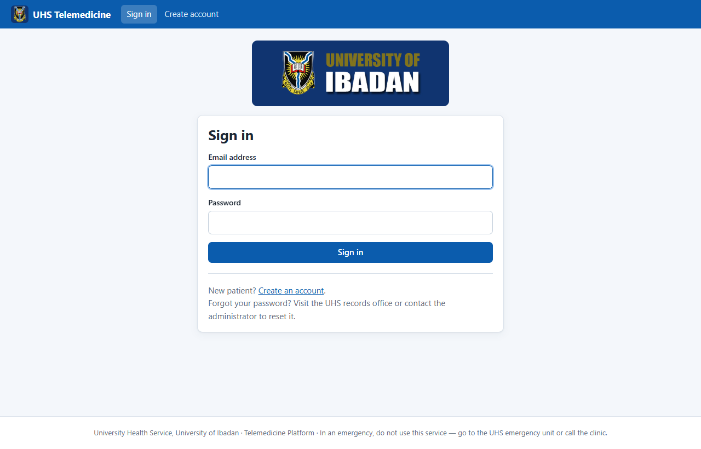
</p>

### 👩‍🎓 Patient

<table>
<tr>
<td width="50%"><br><sub><b>Dashboard</b>: upcoming appointments and recent consultations</sub></td>
<td width="50%">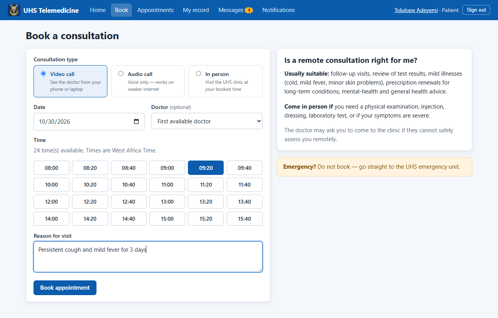<br><sub><b>Book</b>: choose video, audio or in person, and pick from free slots only</sub></td>
</tr>
<tr>
<td width="50%">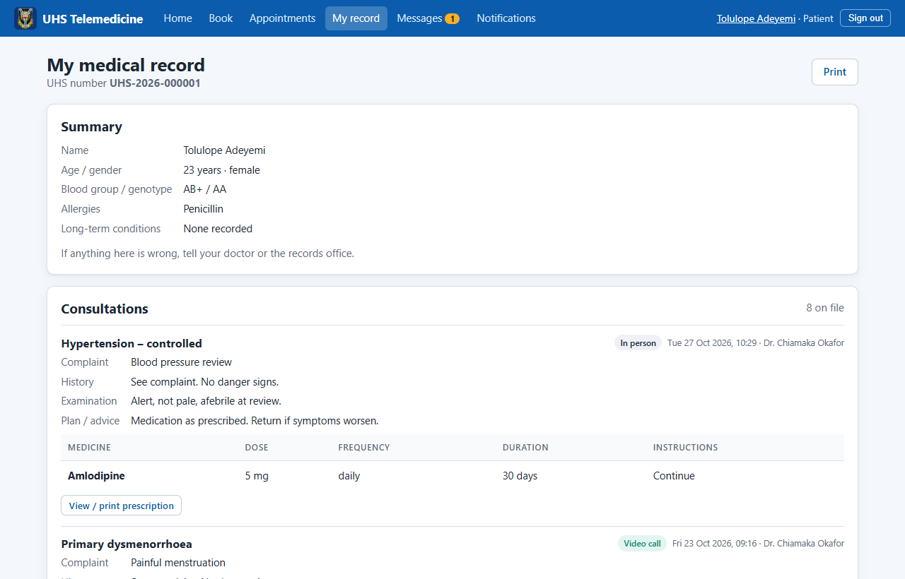<br><sub><b>My record</b>: diagnoses, prescriptions (printable), vitals, history</sub></td>
<td width="50%">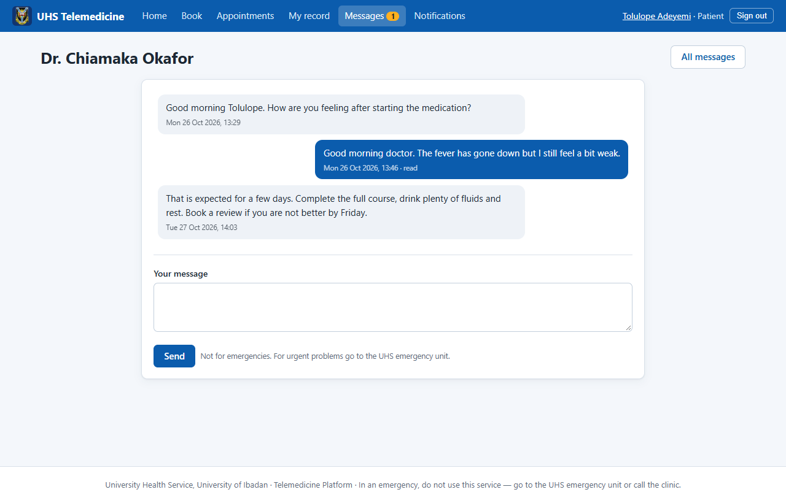<br><sub><b>Messages</b>: secure follow-up with the doctor instead of phone calls</sub></td>
</tr>
</table>

### 🩺 Doctor

<table>
<tr>
<td width="50%">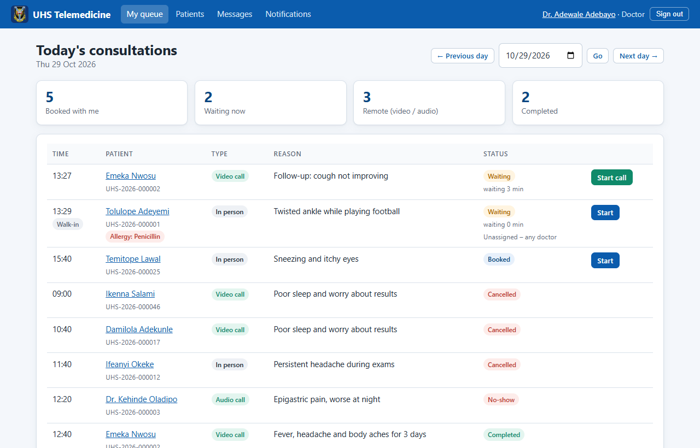<br><sub><b>My queue</b>: waiting times, walk-ins, allergy alerts, remote calls</sub></td>
<td width="50%">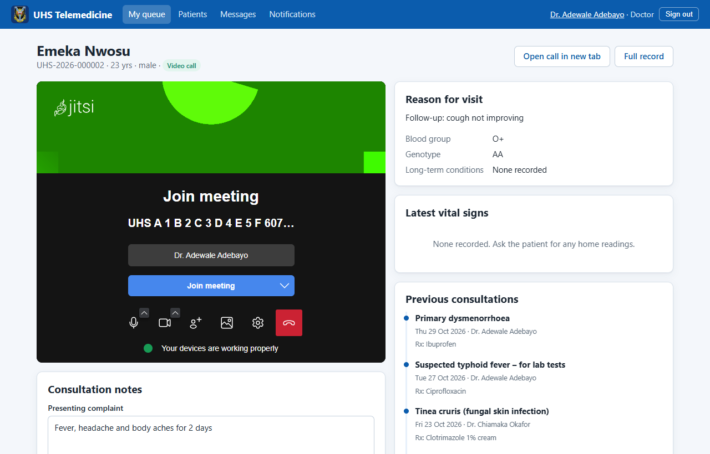<br><sub><b>Remote consultation</b>: embedded video call beside the notes, record and history</sub></td>
</tr>
</table>

### 🗂️ Nurse / Records office

<table>
<tr>
<td width="50%"><br><sub><b>Today</b>: clinic-wide queue, check-in, patient search before registering</sub></td>
<td width="50%">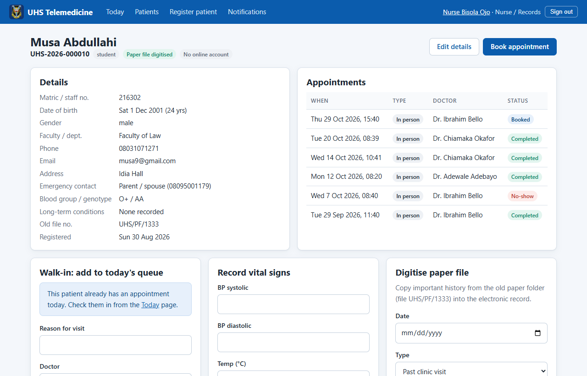<br><sub><b>Patient file</b>: walk-in, vital signs, digitise the paper folder</sub></td>
</tr>
</table>

### 📊 Administrator

<table>
<tr>
<td width="50%"><br><sub><b>Service dashboard</b>: peak hours, waiting time, remote share, workload</sub></td>
<td width="50%"><br><sub><b>Audit log</b>: who viewed or changed which record, and when</sub></td>
</tr>
</table>

### 📱 Works on phones

<p align="center">
  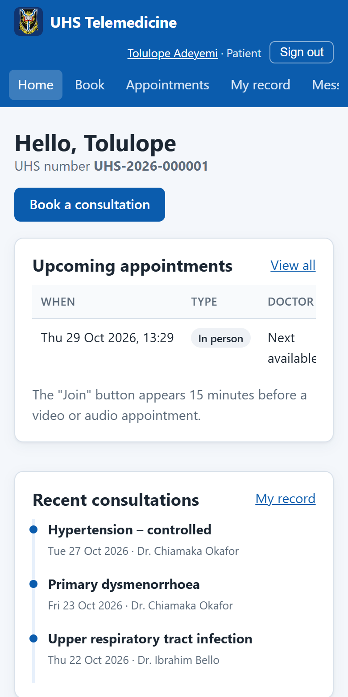
</p>

---

## 👥 Features by user role

<details open>
<summary><b>Patient</b> (student, staff, dependant)</summary>

- Create an account (with data-protection consent) or have the records office enable online access for an existing record.
- Book video, audio or in-person appointments; choose a doctor or "first available".
- View and cancel appointments; **Join consultation** appears 15 minutes before a remote appointment.
- View the medical record: consultations, prescriptions (printable), vitals, history.
- Secure messages with doctors they have seen; in-app and email notifications.
- Update contact and emergency contact details.
</details>

<details open>
<summary><b>Doctor</b></summary>

- Daily queue showing waiting time, walk-ins, allergy warnings and late/no-show patients.
- Start in-person or remote consultations. Remote calls are embedded next to the notes form.
- Consultation notes (complaint, history, examination, diagnosis, plan), structured prescriptions, follow-up date and message.
- Patient search and full record view (including history captured from paper files).
- Secure messaging with patients.
</details>

<details open>
<summary><b>Nurse / Records officer</b></summary>

- Today's queue for the whole clinic: check-in, record vitals, mark no-show, cancel.
- Register patients with duplicate warnings; edit demographics and medical summary.
- **Digitise paper files**: record the old file number, add history entries, mark the file fully digitised.
- Register **walk-ins** (straight into the queue) and **book on behalf of phone callers**.
- Enable online access for an existing patient after an ID check. A one-time temporary password is shown.
- Cannot see consultation notes or prescriptions (need-to-know principle).
</details>

<details open>
<summary><b>Administrator</b></summary>

- Service dashboard (7/30/90 days).
- Create staff accounts (doctor, nurse, admin) with temporary passwords; activate/deactivate accounts; reset passwords.
- Audit log of sign-ins, record views and changes; email outbox.
- Cannot see clinical records.
</details>

### Access matrix

| Data | Patient (own) | Doctor | Nurse/Records | Admin |
|---|:---:|:---:|:---:|:---:|
| Demographics, allergies | ✅ view | ✅ view | ✅ view/edit | — |
| Vitals, past history | ✅ view | ✅ view | ✅ view/add | — |
| Consultation notes, prescriptions | ✅ view | ✅ view/add | — | — |
| Appointments | ✅ own | ✅ own queue | ✅ all | aggregate only |
| Statistics, user accounts, audit log | — | — | — | ✅ |

---

## 🧰 Technology stack

| Layer | Choice | Why |
|---|---|---|
| Runtime | **Node.js 22+** (developed on Node 24) | One language (JavaScript) for the whole system; widely used and easy to host. |
| Web framework | **Express 5** | Small, well-documented, and standard for Node web apps. |
| Views | **EJS** server-rendered templates | Simple pages that work on low-end phones and slow networks; no front-end build step. |
| Database | **SQLite** via `@libsql/client`: a local file in development, a hosted **Turso** database in the cloud | No database server to install locally; the same SQL runs on Turso, which keeps the data on serverless hosting where files are not kept. |
| Hosting | **Vercel** (serverless function + Vercel Cron) | Free tier, HTTPS by default, automatic deployments from GitHub. Any Node host also works with `npm start`. |
| Video/audio | **Jitsi Meet** (external API) | Free, open source, runs in the browser with no app install, and can be self-hosted by the university. |
| Auth | `express-session` (stored in SQLite) + `bcryptjs` | Password hashing and server-side sessions with idle timeout. |
| Email | `nodemailer` | Works with any SMTP provider. Without SMTP, emails are saved to an outbox for demonstrations. |
| Tests | Node's built-in test runner (`node:test`) | No extra test framework needed. |

There are no front-end frameworks or CDNs apart from Jitsi; all CSS and JavaScript is local.

---

## 🚀 Quick start

### Requirements
- **Node.js 22 or newer** (check with `node -v`). Download from <https://nodejs.org>.
- Internet access is needed **only** for video/audio calls (Jitsi). Everything else works offline.

### Install and run

```bash
# 1. Get the code
git clone https://github.com/Jayminai/Remote-HealthCare.git
cd Remote-HealthCare

# 2. Install dependencies
npm install

# 3. (Optional) create a settings file
cp .env.example .env        # Windows PowerShell: Copy-Item .env.example .env

# 4. Load demo data (deletes and recreates data/uhs.db)
npm run seed

# 5. Start the server
npm start
```

Then open **<http://localhost:3000>** in a browser.

| Command | What it does |
|---|---|
| `npm start` | Start the server. |
| `npm run dev` | Start and restart automatically when files change. |
| `npm test` | Run the automated tests (uses a temporary database). |
| `npm run seed` | Reset the database with demo data. **Deletes existing data.** |

> [!NOTE]
> **Without demo data:** if you skip `npm run seed`, the first `npm start` creates an empty database and one
> administrator (`admin@uhs.ui.edu.ng` / `ChangeMe123`, or `ADMIN_EMAIL` / `ADMIN_PASSWORD` from `.env`), who
> must change the password at first sign-in and can then create staff accounts.

---

## 🔑 Demo accounts

After `npm run seed`:

| Role | Email | Password |
|---|---|---|
| 🛡️ Administrator | `admin@uhs.ui.edu.ng` | `Admin@1234` |
| 🩺 Doctor | `dr.adebayo@uhs.ui.edu.ng` (also `dr.okafor@…`, `dr.bello@…`) | `Doctor@1234` |
| 🗂️ Nurse / Records | `nurse.ojo@uhs.ui.edu.ng` | `Nurse@1234` |
| 👩‍🎓 Patient | `tolulope.adeyemi@stu.ui.edu.ng` (also `emeka.nwosu@stu.ui.edu.ng`) | `Patient@1234` |

The seed creates 3 doctors, 1 nurse, 1 admin and 50 patients (some with paper files only and no online account).
It also creates about 30 days of appointment history with a morning peak, today's queue, upcoming bookings and a
sample message thread.

> [!TIP]
> Use a **different browser or a private window** for each role so you can be signed in as several people at once.

### Suggested demonstration (≈10 minutes)

1. **Patient books a remote consultation.** Sign in as Tolulope → **Book** → *Video call* → pick a date and time → describe the reason → *Book*. A confirmation appears under **Notifications** and in Admin → **Email outbox**.
2. **Records office handles a walk-in.** Sign in as the nurse → **Patients** → search "Musa" → open the record → *Add to queue* → record vitals.
3. **Duplicate prevention.** Nurse → **Register patient** → enter "Adeyemi Tolulope" with date of birth 12 Apr 2003 → the existing record is flagged.
4. **Digitising a paper file.** On a patient with an old file number, add a history entry (e.g. a 2022 malaria episode) and click *Mark paper file as fully digitised*.
5. **Doctor consultation.** Sign in as a doctor → **My queue** → *Start* (or *Start call* for a remote appointment) → fill in the notes, add a prescription and a follow-up message → *Save and complete*.
6. **Patient follows up.** As the patient, open **My record** to see the diagnosis and print the prescription. Open **Messages** to read and reply to the doctor's follow-up.
7. **Management view.** Sign in as admin → **Dashboard** (peak hours, average wait in person vs remote, remote share, no-show rate) → **Audit log**.

> [!TIP]
> To test a live video call, book a remote appointment for **today** within the next 15 minutes (or use one from
> the seeded queue). Then click *Join consultation* as the patient and *Start call* as the doctor in another browser.

---

## ☁️ Deploying to Vercel

The app runs on Vercel as a single serverless function ([api/index.js](api/index.js), configured in [vercel.json](vercel.json)).
Serverless functions cannot keep files between requests, so on Vercel the data lives in a hosted **Turso** database
(SQLite-compatible). Locally nothing changes: without `TURSO_DATABASE_URL` the app uses `data/uhs.db`.

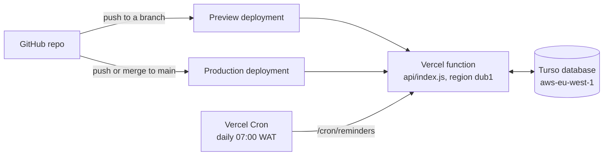

### One-time setup

1. **Import the repository**: [vercel.com/new](https://vercel.com/new) → *Import Git Repository* → `Remote-HealthCare`.
   Framework preset **Other**; leave the build, output and install commands at Vercel's defaults.
2. **Add the database**: in the Vercel project open *Storage* → *Create Database* → **Turso**, choose the
   **Ireland (aws-eu-west-1)** region and connect it to the project. This adds `TURSO_DATABASE_URL` and
   `TURSO_AUTH_TOKEN` automatically. (Or create the database at [turso.tech](https://turso.tech) and add both variables yourself.)
3. **Add environment variables** in *Settings* → *Environment Variables* (Production and Preview):

   | Variable | Value |
   |---|---|
   | `SESSION_SECRET` | A long random string, e.g. from `node -e "console.log(require('crypto').randomBytes(32).toString('hex'))"`. **Required**: the app will not start without it. |
   | `CRON_SECRET` | Another long random string. Vercel sends it when calling `/cron/reminders`. |
   | `SEED_DEMO` | `true` to load the demo accounts and data into the empty database on first start (for demonstrations). |
   | `APP_URL` | The deployment's address, e.g. `https://remote-healthcare.vercel.app` (used in email links). |
   | `SMTP_*`, `MAIL_FROM` | Optional, for real email delivery. |

4. **Redeploy** so the new variables take effect.

The first request after a deployment creates the tables (and loads the demo data if `SEED_DEMO=true`); later
requests are fast. Every push to a branch creates a **preview deployment**; pushes to `main` deploy **production**.

> [!NOTE]
> **Reminders on Vercel.** There is no always-running process, so reminders are sent during normal traffic (at most
> once a minute) and by a **daily Vercel Cron job** at 07:00 WAT (the Hobby plan allows one run per day). On a
> server started with `npm start` the reminder job runs every minute as usual.

---

## ⚙️ Configuration

All settings are environment variables, usually placed in a `.env` file (see [.env.example](.env.example)).

<details>
<summary><b>Show all settings</b></summary>

| Variable | Default | Purpose |
|---|---|---|
| `PORT` | `3000` | HTTP port. |
| `APP_URL` | `http://localhost:3000` | Public address, used in email links. |
| `NODE_ENV` | `development` | Set to `production` for secure cookies and hidden error details. |
| `SESSION_SECRET` | dev value | **Required in production.** A long random string. |
| `SESSION_MINUTES` | `30` | Sign out after this many minutes of inactivity. |
| `DB_PATH` | `data/uhs.db` | Local SQLite database file (ignored when `TURSO_DATABASE_URL` is set). |
| `TURSO_DATABASE_URL`, `TURSO_AUTH_TOKEN` | empty | Hosted Turso database. Required on Vercel. |
| `SEED_DEMO` | unset | `true` loads the demo data into an **empty** database on first start. |
| `CRON_SECRET` | empty | Secret for the `/cron/reminders` endpoint (Vercel Cron). |
| `CLINIC_OPEN` / `CLINIC_CLOSE` | `08:00` / `16:00` | Consultation hours (West Africa Time). |
| `SLOT_MINUTES` | `20` | Length of each appointment slot. |
| `CLINIC_DAYS` | `1,2,3,4,5` | Days with consultations (0 = Sunday). |
| `MAX_DAYS_AHEAD` | `30` | How far ahead patients can book. |
| `JITSI_DOMAIN` | `meet.jit.si` | Video server. See [limitations](#-limitations-and-future-work). |
| `SMTP_HOST`, `SMTP_PORT`, `SMTP_USER`, `SMTP_PASS`, `MAIL_FROM` | empty | Real email delivery. Leave `SMTP_HOST` empty to record emails in the outbox only. |
| `ADMIN_EMAIL`, `ADMIN_PASSWORD` | see above | First admin, created on first start if none exists. |
| `TRUST_PROXY` | unset | Set to `1` behind a reverse proxy that handles HTTPS (automatic on Vercel). |

</details>

All times are handled in **Africa/Lagos** time (WAT, UTC+1).

---

## 🏗️ System design

### Architecture

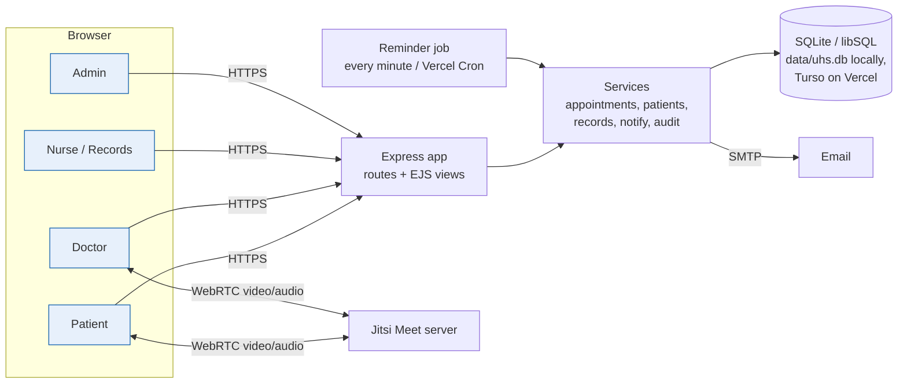

- **Routes** (`src/routes`) handle HTTP requests for each area (patient, doctor, records, admin, messages…).
- **Services** (`src/services`) contain the business rules, such as slot generation, booking, duplicate detection, reminders and notifications.
- **Views** (`src/views`) are EJS templates; `public/` holds CSS and small JavaScript files.
- The **reminder job** runs inside the server every minute. A `reminders_sent` table makes sure each reminder is sent only once.
- Video and audio go **directly between browsers through the Jitsi server**; the application only generates the private room name.

### Remote consultation flow

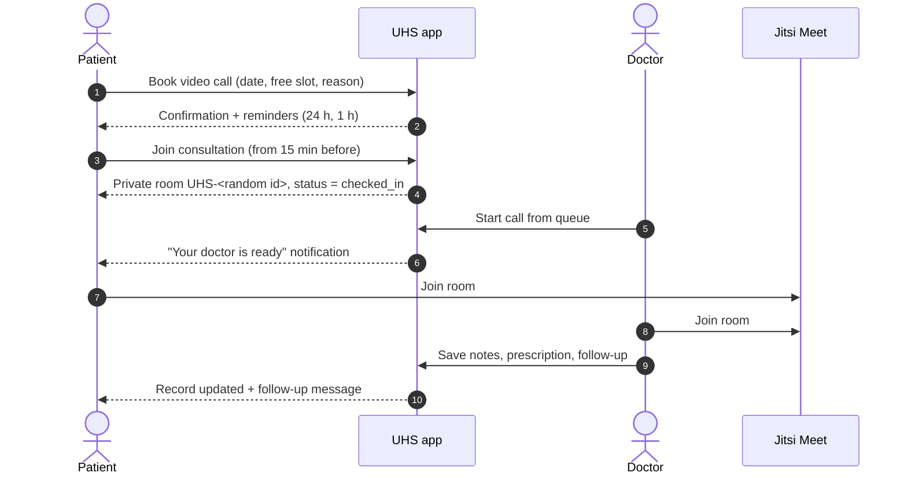

### Appointment life cycle

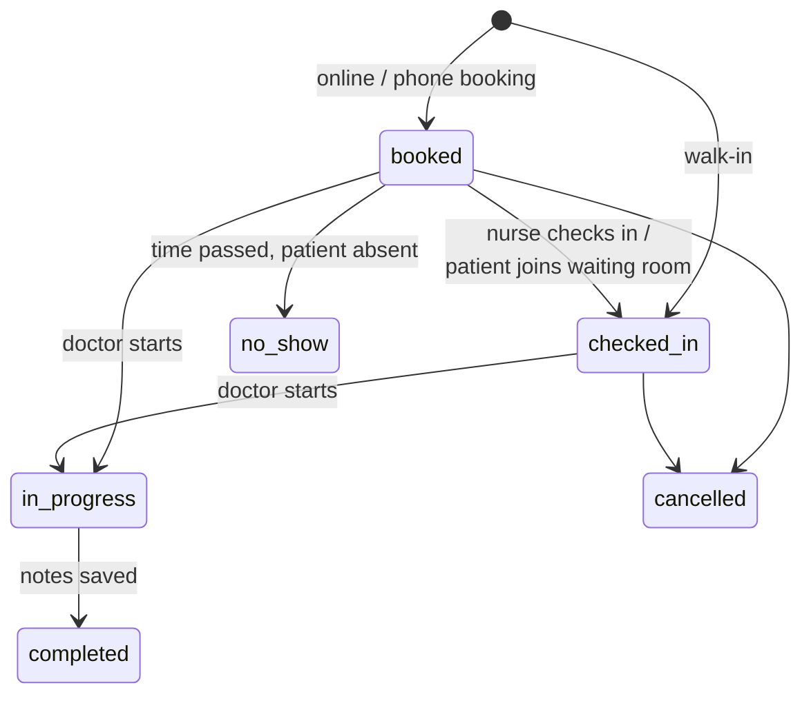

**Waiting time** = time from `checked_in_at` (arrival or joining the online waiting room) to `started_at` (doctor starts).

### Key business rules
- Slots are generated from clinic hours. Past slots and non-clinic days are never offered.
- A doctor cannot be double-booked: this is checked in code and enforced by a **unique database index** on `(doctor_id, scheduled_at)`, so it holds even if two people book at the same moment.
- A patient cannot hold two active appointments at the same time.
- "First available doctor" picks the free doctor with the **fewest appointments that day** (load balancing).
- Remote consultations require an online account. Patients without one can still be booked in person by phone.
- Patients can enter the call from **15 minutes before** the appointment until the end of that day.

---

## 🗄️ Database design

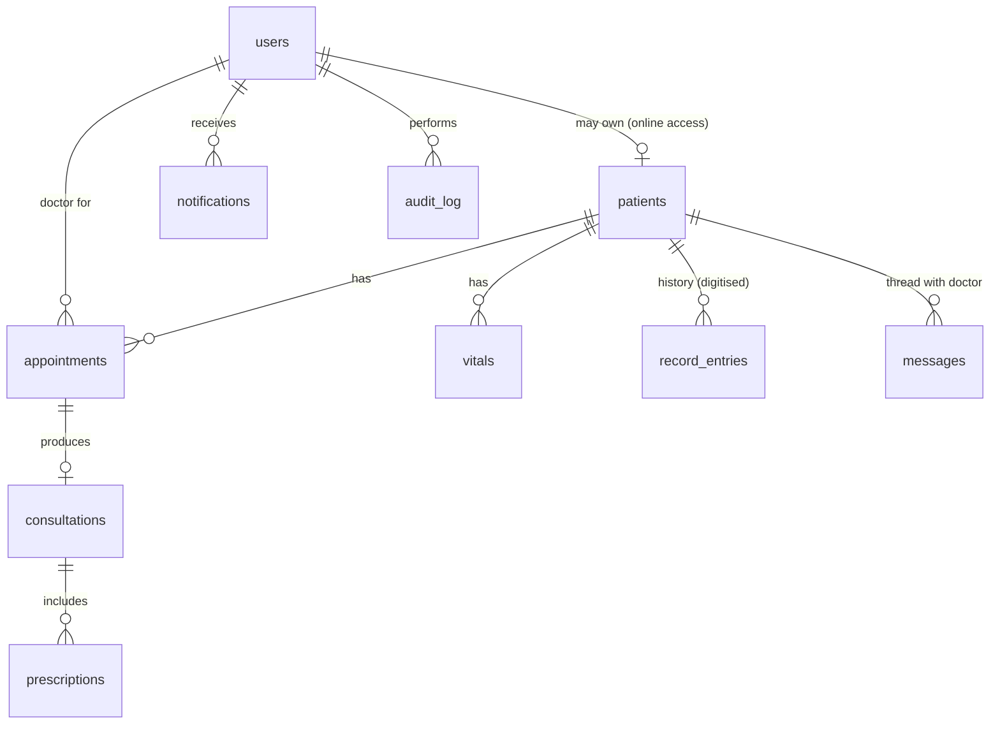

<details>
<summary><b>Table descriptions</b></summary>

| Table | Purpose |
|---|---|
| `users` | Everyone who can sign in, with a role: `patient`, `doctor`, `nurse`, `admin`. |
| `patients` | The medical record folder: UHS number, matric/staff number, demographics, allergies, old paper file number, digitisation status. Can exist without a user (walk-ins). |
| `appointments` | Bookings and walk-ins with mode, status, booking channel, private room id and check-in/start/end times. |
| `vitals` | Blood pressure, temperature, pulse, etc., taken at triage. |
| `consultations` | Doctor's notes for an encounter, including follow-up date/note. |
| `prescriptions` | Medicine lines linked to a consultation. |
| `record_entries` | History copied from paper files or reported by the patient/other hospitals. |
| `messages` | Secure patient–doctor messages. |
| `notifications` | In-app notifications. |
| `reminders_sent` | Prevents sending the same reminder twice. |
| `email_outbox` | Every email sent (or logged). |
| `audit_log` | Who did what and when. |
| `sessions` | Sign-in sessions. |

</details>

The full schema with comments is in [src/db/schema.sql](src/db/schema.sql).

---

## 🔒 Security and privacy

Health information is sensitive personal data under the **Nigeria Data Protection Act 2023 (NDPA)**. The system includes:

| Area | Protection |
|---|---|
| Consent | Checkbox at self-registration explaining how data is used. |
| Passwords | **Hashed with bcrypt.** At least 8 characters with letters and numbers. Staff-issued temporary passwords **must be changed at first sign-in**. |
| Access control | Role checks on every route (see the [access matrix](#access-matrix)). Admins cannot see clinical records; nurses cannot see consultation notes. |
| Audit | Sign-ins (including failures), every patient-record view, and every change are logged. |
| Brute force | 5 failed sign-ins per email/IP lock that combination for 15 minutes. Failed logins take about the same time whether or not the email exists. |
| Sessions | HTTP-only, SameSite cookies; new session ID at login (prevents session fixation); **30-minute idle timeout**; `Secure` cookies in production. |
| Forms | **CSRF tokens** on every form. |
| Browser | **Content Security Policy** and other security headers. No inline scripts; only the Jitsi domain may load scripts or frames. Pages are sent with `Cache-Control: no-store`. |
| Injection / redirects | Parameterised SQL everywhere; redirects only to local paths. |
| Call privacy | 24 random hex characters per appointment room, never reused. |
| Email | Message emails say only that a message exists; the content stays in the system. |
| Identity | A self-registration matching an existing record is refused and sent to the records office, so no one can claim another person's file online. |

> [!WARNING]
> **For a real deployment** also: serve over **HTTPS**, set a strong `SESSION_SECRET`, back up `data/uhs.db`
> regularly to an encrypted location, self-host Jitsi on university infrastructure, and agree a data-retention
> policy with UHS.

---

## 🧪 Testing

```bash
npm test
```

```
ℹ tests 18
ℹ pass 18
ℹ fail 0
```

18 automated tests run against a temporary database file that is deleted afterwards:

- **Unit tests** ([tests/unit.test.js](tests/unit.test.js)): date handling, UHS number generation, duplicate detection (reordered names, phone formats, ID numbers), form validation, slot generation, least-busy doctor assignment, double-booking prevention (application and database level), reminders sent exactly once, safe redirects, password policy, doctor titles, transactions (rollback and nested calls).
- **End-to-end HTTP tests** ([tests/http.test.js](tests/http.test.js)):
  - The full patient journey: register → duplicate registration blocked → book → doctor starts and completes the consultation with a prescription → patient sees the record, prescription, follow-up message and notification → patient replies → another patient cannot read the thread.
  - Records office: registration with duplicate warning/override, walk-in, vitals (out-of-range values refused), nurse cannot see clinical notes, enabling online access with forced password change.
  - Admin: dashboard, user creation and deactivation, no access to clinical records.
  - Security: CSRF rejection, failed-login auditing, access control redirects.

---

## 📁 Project structure

<details>
<summary><b>Show folder tree</b></summary>

```
Remote-HealthCare/
├── src/
│   ├── server.js            # Entry point: starts web server and reminder job
│   ├── app.js               # Express setup, middleware, routes
│   ├── config.js            # Settings from environment variables
│   ├── db/
│   │   ├── schema.sql       # Database tables (documented)
│   │   ├── index.js         # Database helper (libSQL: local file or Turso)
│   │   ├── session-store.js # Sessions stored in the database
│   │   ├── bootstrap.js     # Startup: tables, first admin, optional demo data
│   │   ├── demo-data.js     # Demo data, written in one atomic batch
│   │   └── seed.js          # npm run seed
│   ├── middleware/
│   │   ├── auth.js          # Sign-in and role checks
│   │   └── security.js      # Security headers, CSRF, login rate limit
│   ├── services/
│   │   ├── appointments.js  # Slots, booking, life cycle
│   │   ├── patients.js      # Registration, UHS numbers, duplicate detection, search
│   │   ├── records.js       # Assembles the medical record
│   │   ├── reminders.js     # Reminder background job
│   │   ├── notify.js        # In-app notifications and email
│   │   └── audit.js         # Audit log
│   ├── routes/              # auth, account, patient, doctor, records, patients, consult, messages, notifications, admin, api
│   ├── utils/               # time.js (dates in WAT), validate.js (input checks)
│   └── views/               # EJS templates per area + shared partials
├── public/
│   ├── css/style.css
│   └── js/                  # app.js, booking.js (slot picker), consult.js (video + prescription rows)
├── api/index.js             # Vercel serverless entry point
├── docs/
│   ├── images/              # University of Ibadan logo
│   └── media/               # README screenshots and walkthrough GIF
├── tests/                   # Automated tests
├── .env.example
├── vercel.json              # Vercel routing, region, cron and function settings
└── package.json
```

</details>

---

## 🧭 Limitations and future work

> [!CAUTION]
> **Public Jitsi server limits.** The free `meet.jit.si` service **limits embedded calls to about 5 minutes** and
> may ask the first participant to sign in (Google/GitHub) to start the meeting. For demonstrations, the
> **"Open call in new tab"** button avoids the embed limit. For real use, UHS should **self-host Jitsi** (free, open
> source) on a university server, or use 8x8's JaaS, and set `JITSI_DOMAIN`.

- **SMS reminders** were not implemented (they need a paid provider such as Termii or Twilio). Email and in-app reminders are included, and `services/notify.js` is the single place where an SMS channel would be added.
- **Integration with existing records.** The interview mentions "authorized integration with current records". No external UHS system was available, so paper files are digitised manually through the records office. A future version could import from an existing system once its format and authorisation are agreed.
- **Single clinic, simple scheduling.** Doctors share one set of clinic hours; there is no per-doctor rota or leave. A rota table would be the next step.
- **No pharmacy or laboratory modules.** Prescriptions are printable and shown to the patient, but there is no dispensing workflow or lab-request/result system yet.
- **Password reset by email** is not included; resets are done by the administrator (temporary password).
- **SQLite / Turso** suits a campus clinic. A very large deployment could move to PostgreSQL, since the SQL is mostly standard.
- **Reminders on Vercel Hobby** run during site traffic plus one daily cron; a paid plan (or `npm start` on a normal server) gives minute-by-minute reminders.
- **Two-factor authentication** for staff accounts would strengthen security.

### Assumptions made
- Patients are UI students, staff or registered dependants; students and staff are identified by matric/staff number.
- Consultation hours are Monday–Friday, 08:00–16:00, with 20-minute slots (all configurable).
- A doctor decides whether a case is suitable for remote care; the plan field can direct a patient to come in person.
- Nurses and records officers share one role, since both handle registration, check-in and vitals.

---

## 🛠️ Troubleshooting

| Problem | Solution |
|---|---|
| `--env-file-if-exists` is not a valid option | Upgrade Node.js to 22 or newer. |
| Vercel: "SESSION_SECRET must be set in production" | Add `SESSION_SECRET` in the Vercel project's environment variables and redeploy. |
| Vercel: data disappears, or "no such table" | `TURSO_DATABASE_URL` / `TURSO_AUTH_TOKEN` are missing. Connect the Turso database to the project and redeploy. |
| Port 3000 already in use | Set another port: `PORT=3001 npm start` (PowerShell: `$env:PORT=3001; npm start`). |
| Video area says the service could not be loaded | Check your internet connection or firewall, or click **Open call in new tab**. |
| Camera/microphone not working | Allow access in the browser's address bar. Browsers only allow the camera on `localhost` or HTTPS sites. |
| Call ends after ~5 minutes | This is the `meet.jit.si` embed limit; use **Open call in new tab** or a self-hosted Jitsi server. |
| "Form expired" message | The page was open too long (session timeout). Refresh and try again. |
| No free slots shown | The date is a weekend/holiday, in the past, more than 30 days ahead, or fully booked. |
| Want a clean database | Stop the server, then run `npm run seed` (demo data) or delete the `data/` folder (empty system). |

---

<div align="center">

<sub>Built as a case study for the <b>University Health Service, University of Ibadan</b> · Telemedicine Platform for Remote Healthcare Consultations</sub>

<sub><i>Telemedicine is not for emergencies. In an emergency, go to the UHS emergency unit.</i></sub>

</div>
