<div align="center">


# UHS Telemedicine Platform

**A web-based platform for remote healthcare consultations at the University Health Service (UHS), University of Ibadan**

[](https://nodejs.org)
[](https://expressjs.com)
[](https://turso.tech)
[](https://ejs.co)
[](https://jitsi.org/meet)
[](#testing)
[](#security-and-privacy)

[Quick start](#quick-start) | [Demonstration accounts](#demonstration-accounts) | [Screenshots](#screenshots) | [System design](#system-design) | [Security](#security-and-privacy) | [Deployment](#deploying-to-vercel)

<br>

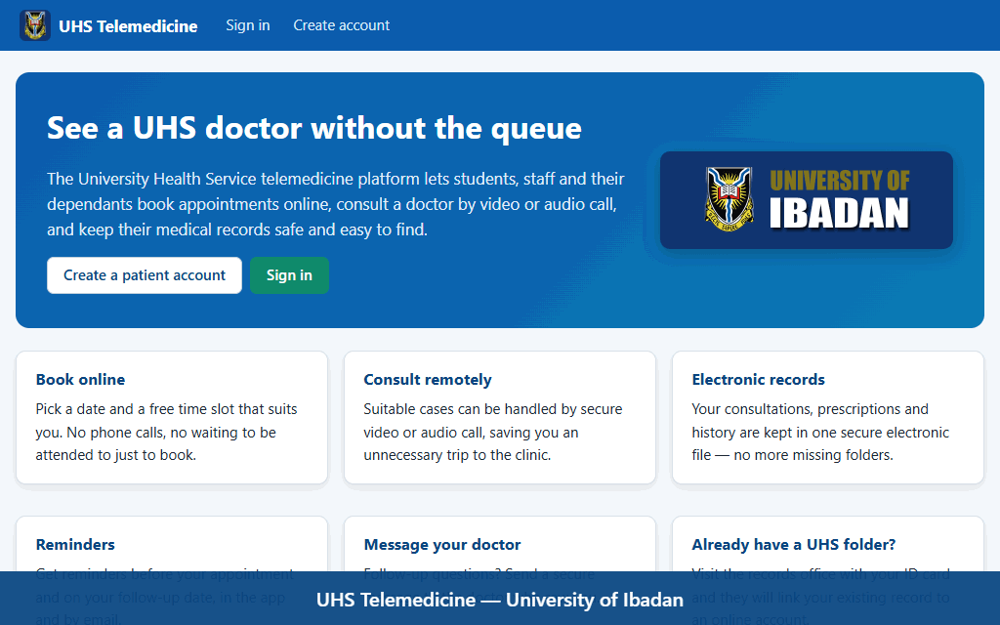

<sub>Walkthrough recorded from the running application with the demonstration data (<code>npm run seed</code>).</sub>

</div>

---

## Project information

| | |
|---|---|
| **Title** | Telemedicine Platform for Remote Healthcare Consultations |
| **Case study** | University Health Service (UHS), University of Ibadan |
| **Course** | CSC 476 Project, 2025/2026 session, Group 62 |
| **Institution** | Department of Computer Science, University of Ibadan Distance Learning Centre |
| **Supervisor** | Professor Bolanle Oladejo |
| **Team** | George Godstime (Team Leader, E050801), Ibrahim Ali (E048012), Magret Ojediran (E051968) |

---

## Table of contents

1. [Overview](#overview)
2. [Background and problem statement](#background-and-problem-statement)
3. [Requirements traceability](#requirements-traceability)
4. [Screenshots](#screenshots)
5. [Features by user role](#features-by-user-role)
6. [Technology stack](#technology-stack)
7. [Quick start](#quick-start)
8. [Demonstration accounts](#demonstration-accounts)
9. [Deploying to Vercel](#deploying-to-vercel)
10. [Configuration](#configuration)
11. [System design](#system-design)
12. [Database design](#database-design)
13. [Security and privacy](#security-and-privacy)
14. [Testing](#testing)
15. [Project structure](#project-structure)
16. [Limitations and future work](#limitations-and-future-work)
17. [Troubleshooting](#troubleshooting)

---

## Overview

The UHS Telemedicine Platform allows patients of the University Health Service (students, staff and registered
dependants) to **book appointments online**, **consult a doctor by video or audio call**, and access a **secure
electronic medical record**. The records office is given tools to **digitise paper files** and to handle **walk-in
patients and telephone bookings**, while administrators receive a **service dashboard** that reports on demand,
waiting times and workload.

| Capability | Description |
|---|---|
| Online booking | Only free slots are offered; double-booking is prevented; the least-busy doctor is assigned when no preference is given. |
| Remote consultation | A private Jitsi Meet room is created for every remote appointment, with an audio-only option for weak connections. |
| Electronic medical records | One record per patient, with duplicate detection at registration and digitisation of existing paper files. |
| Management reporting | Peak hours, waiting times, share of remote consultations, doctor workload and a complete audit log. |

---

## Background and problem statement

An interview with UHS staff established the following picture of the existing service:

| Topic | Finding |
|---|---|
| Patient volume | Varies by day and clinic service, with a **peak in the morning** when students and staff arrive. |
| Appointments | Arranged **in person or by telephone**, or through existing clinic procedures. **Walk-in** patients are also seen. |
| Records | **Mostly paper-based**, with very little digital support. |
| Missing or duplicate files | Paper systems are **vulnerable to misplaced files and duplicate records**. |
| Staffing | High demand places pressure on health workers and **increases waiting times**. |
| Communication between visits | Limited to **telephone calls or further visits**. |
| Value of remote consultation | Suitable cases could be handled remotely, **reducing unnecessary visits** and easing scheduling. |
| Priority improvements | Better **appointment management**, **shorter waiting times**, and **secure, easy retrieval** of patient information. |
| Requested features | Online booking, secure video and audio consultations, patient registration, electronic medical records, prescriptions where appropriate, reminders, follow-up messages and administrative dashboards. |

> [!IMPORTANT]
> **Problem statement.** UHS relies on paper records and manual scheduling in person and by telephone. This results
> in long waits at peak times, files that are lost or duplicated, and follow-up that takes place only by telephone or
> in person. There is no channel for handling suitable cases remotely, and management has no reliable data on demand
> or waiting times.

**Aim.** To design and implement a secure telemedicine platform that fits the existing UHS workflow (walk-ins,
telephone bookings and paper files remain supported) while adding online booking, remote consultations, electronic
records, reminders, follow-up messaging and management reporting.

---

## Requirements traceability

Each requirement identified in the interview is addressed by a specific part of the application:

| Requirement or finding | How the system addresses it | Location in the application |
|---|---|---|
| Online appointment booking | Patients select video, audio or in-person consultation, a date and a free slot. Slots are generated from clinic hours, and the database prevents double-booking. | Patient > **Book** |
| Peak-hour pressure on staff | "First available doctor" assigns the **least-busy free doctor**. Remote consultations move suitable cases out of the waiting room. The dashboard reports **peak hours**. | Booking; Admin > **Dashboard** |
| Long waiting times | Check-in and start times are recorded and the **average wait (in person and remote)** is reported. Queues display minutes waited. | Doctor > **My queue**; Admin dashboard |
| Secure video and audio consultations | Each remote appointment receives a **private, randomly named room** (Jitsi Meet) embedded in the application. An audio-only mode is available. | Patient > **Join consultation**; Doctor > **Start call** |
| Patient registration | Online self-registration, or registration by the records office (including walk-ins without an email address). Each patient receives a unique **UHS number**. | `/register`; Nurse > **Register patient** |
| Electronic medical records | A single record holds demographics, allergies, vital signs, consultations, prescriptions, past history and appointments. | Patient > **My record**; Doctor/Nurse > patient page |
| Paper records and existing workflow | The records office can **digitise paper files** (old file number, history entries, "fully digitised" flag). Walk-ins and telephone bookings are fully supported. | Nurse > patient page |
| Missing or duplicate files | **Duplicate detection** checks matric/staff number, name and date of birth (in any word order), and telephone number before a record is created. | Nurse > **Register patient**; `/register` |
| Prescriptions where appropriate | Optional structured prescriptions (medicine, dose, frequency, duration, instructions), shown on the patient's record and **printable**. | Doctor consultation form; Patient > **My record** |
| Reminders | Automatic reminders **24 hours and 1 hour before** appointments and on the **follow-up date**, delivered in-app and by email. | Notifications; Admin > **Email outbox** |
| Follow-up messages | A doctor's follow-up note becomes a **secure message** to which the patient can reply. Messaging updates **live**, including read receipts and typing indicators. | **Messages** |
| Administrative dashboards | Appointments, remote share, waiting times, no-show rate, booking channels, peak hours, daily trend, doctor workload, top diagnoses and digitisation progress. | Admin > **Dashboard** |
| Secure retrieval of information | Role-based access control. Every record view and change is written to the **audit log**. | Admin > **Audit log** |

---

## Screenshots

<sub>All screenshots are taken from the running application with the demonstration data. All names and records are fictional.</sub>

### Public site

<p align="center">
  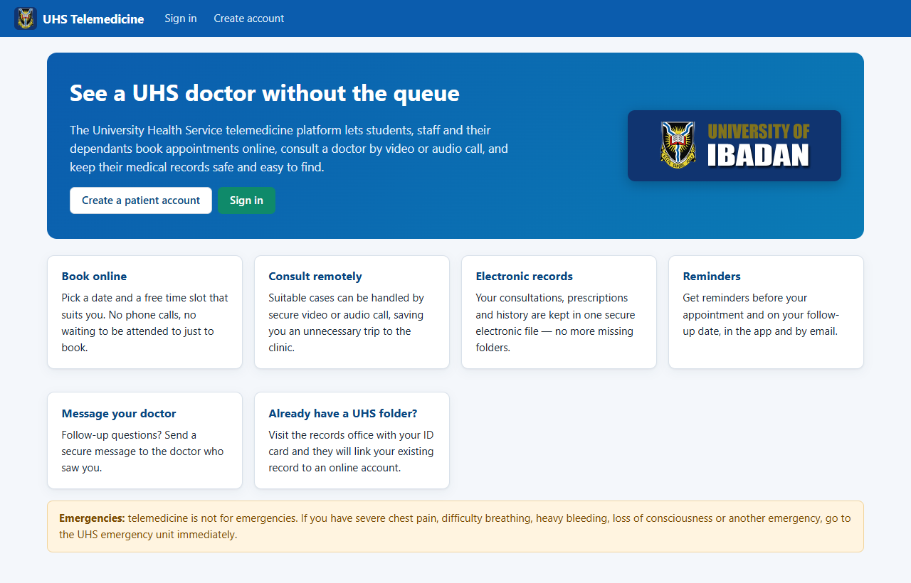
  
</p>

### Staff portal

<p align="center">
  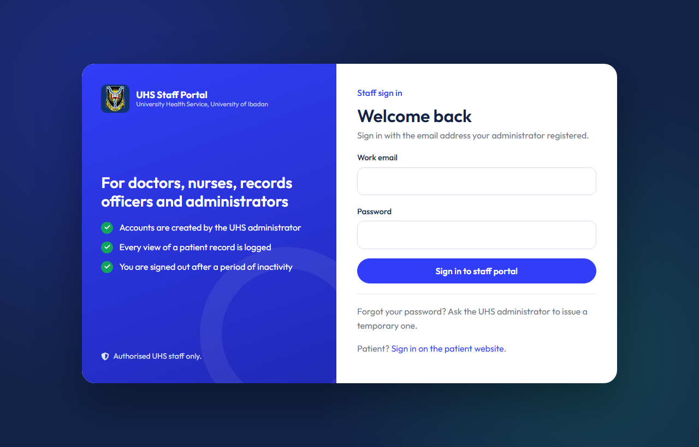
</p>
<p align="center"><sub>Doctors, nurses and records officers sign in at <code>/staff/login</code>, and administrators at <code>/admin/login</code>, separately from patients.</sub></p>

### Patient

<table>
<tr>
<td width="50%">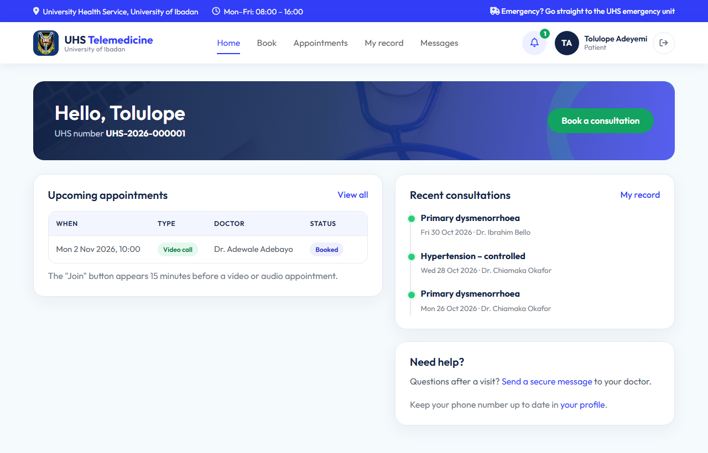<br><sub><b>Dashboard</b>: upcoming appointments and recent consultations</sub></td>
<td width="50%"><br><sub><b>Book</b>: video, audio or in-person consultation, from free slots only</sub></td>
</tr>
<tr>
<td width="50%"><br><sub><b>My record</b>: diagnoses, printable prescriptions, vital signs and history</sub></td>
<td width="50%"><br><sub><b>Messages</b>: secure follow-up with the doctor</sub></td>
</tr>
</table>

### Doctor

<table>
<tr>
<td width="50%"><br><sub><b>My queue</b>: waiting times, walk-ins, allergy alerts and remote calls</sub></td>
<td width="50%"><br><sub><b>Remote consultation</b>: embedded video call beside the notes, record and history</sub></td>
</tr>
</table>

### Nurse and records office

<table>
<tr>
<td width="50%">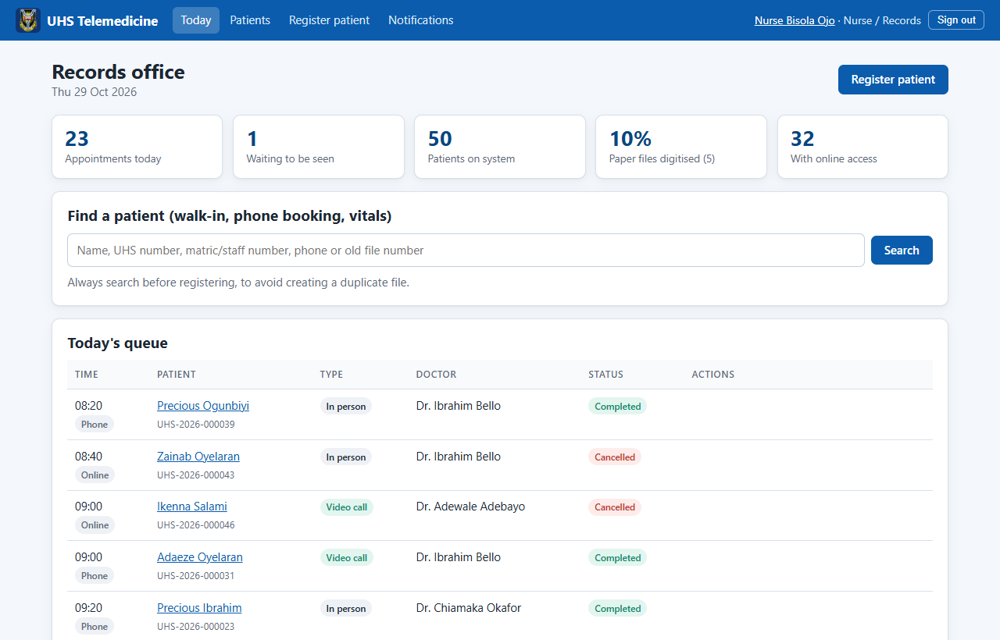<br><sub><b>Today</b>: clinic-wide queue, check-in and patient search before registration</sub></td>
<td width="50%"><br><sub><b>Patient file</b>: walk-in, vital signs and paper-file digitisation</sub></td>
</tr>
</table>

### Administrator

<table>
<tr>
<td width="50%">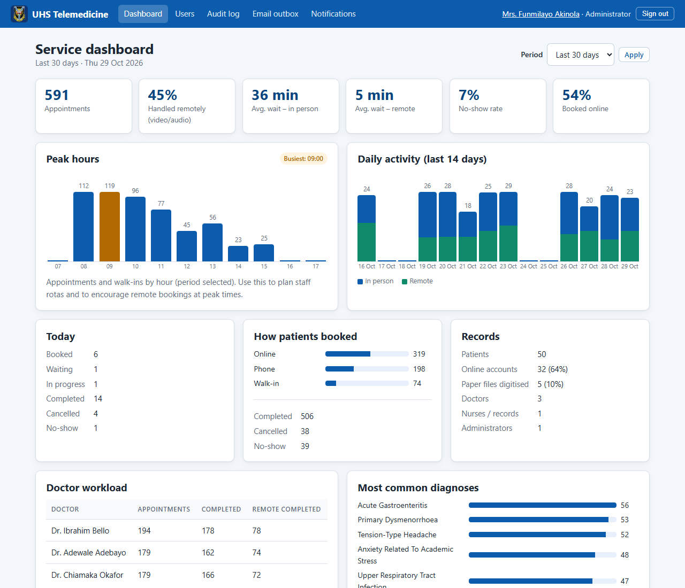<br><sub><b>Service dashboard</b>: peak hours, waiting time, remote share and workload</sub></td>
<td width="50%">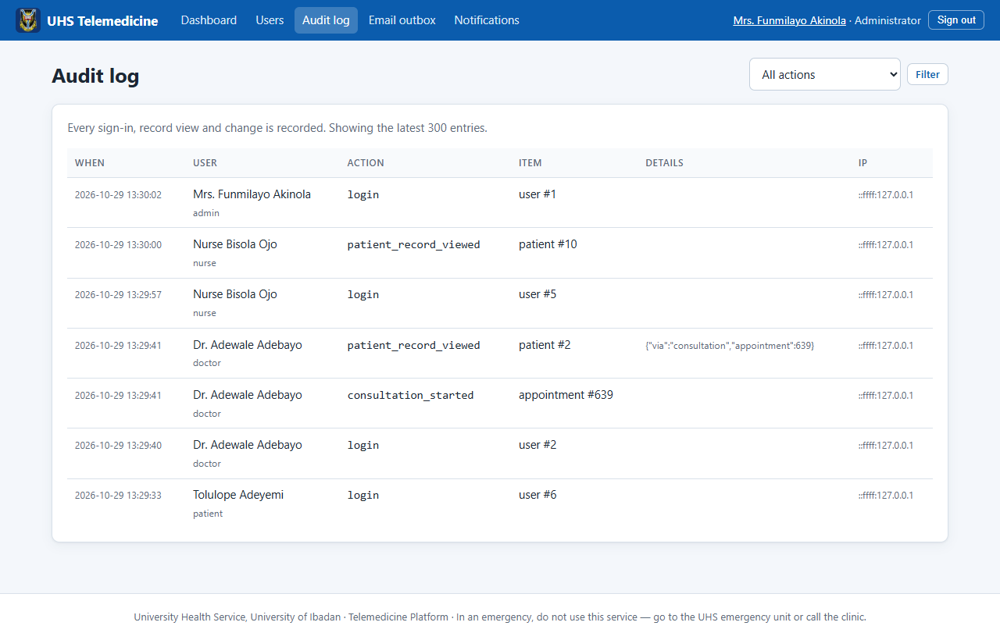<br><sub><b>Audit log</b>: who viewed or changed which record, and when</sub></td>
</tr>
</table>

### Mobile layout

The interface is designed mobile-first. On small screens, tables are presented as one card per row so that no
horizontal scrolling is required, and the messaging pages behave like a messaging application: the conversation
resizes above the on-screen keyboard and the newest message remains in view. Account actions (profile, settings and
sign-out) are available from the menu. Animations used to draw attention to live events are disabled for users whose
device requests reduced motion.

<p align="center">
  
</p>

---

## Features by user role

### Patient (student, staff member or dependant)

- Create an account (with data-protection consent), or have the records office enable online access for an existing record.
- Book video, audio or in-person appointments with a chosen doctor or the first available doctor.
- View and cancel appointments; the **Join consultation** option appears 15 minutes before a remote appointment.
- View the medical record: consultations, printable prescriptions, vital signs and history.
- Exchange secure messages with doctors previously consulted, with in-app and email notifications.
- Receive live updates without reloading: new messages, typing indicators, read receipts, notifications and unread counters.
- Send photographs in messages (for example, of a medicine purchased at a pharmacy). Common formats are supported, including HEIC/HEIF from mobile phones; images are converted to JPEG in the browser before upload.
- Join a video or audio call started by the doctor from a conversation.
- Confirm the email address after registration (link valid for 24 hours) before booking.
- Reset a forgotten password through a one-time email link valid for 1 hour.
- Update contact and emergency contact details.

### Doctor

- Daily queue showing waiting time, walk-ins, allergy warnings and late or absent patients.
- Start in-person or remote consultations, with the video call embedded beside the notes form.
- Record consultation notes (complaint, history, examination, diagnosis, plan), structured prescriptions, and a follow-up date and message.
- Search for patients and view the full record, including history captured from paper files.
- Exchange secure messages with patients, with live updates and photographs.
- Start a video or audio call from an existing conversation; the patient is notified immediately and joins the private room. Only the doctor can start or end such a call.
- The queue refreshes automatically when a booking, check-in or cancellation occurs.

### Nurse and records officer

- Manage the clinic-wide queue for the day: check-in, vital signs, no-show and cancellation.
- Register patients with duplicate warnings; edit demographics and the medical summary.
- **Digitise paper files**: record the old file number, add history entries and mark the file as fully digitised.
- Register **walk-in** patients directly into the queue and **book on behalf of telephone callers**.
- Enable online access for an existing patient after an identity check, using a one-time temporary password.
- No access to consultation notes or prescriptions (need-to-know principle).

All staff have a **My profile** page showing their account details, where they may update their telephone number.
Name, email address and role are managed by an administrator.

### Administrator

- Service dashboard covering the last 7, 30 or 90 days.
- Separate **admin portal** at `/admin` (sign-in at `/admin/login`).
- Create staff accounts (doctor, nurse, administrator) with temporary passwords; activate, deactivate and reset accounts.
- Review the audit log of sign-ins, record views and changes, and the email outbox (including a test-email function).
- No access to clinical records.

### Access matrix

| Data | Patient (own record) | Doctor | Nurse / Records | Administrator |
|---|:---:|:---:|:---:|:---:|
| Demographics, allergies | View | View | View, edit | No access |
| Vital signs, past history | View | View | View, add | No access |
| Consultation notes, prescriptions | View | View, add | No access | No access |
| Appointments | Own | Own queue | All | Aggregates only |
| Statistics, user accounts, audit log | No access | No access | No access | Full access |

---

## Technology stack

| Layer | Technology | Rationale |
|---|---|---|
| Runtime | **Node.js 22+** | A single language (JavaScript) across the system; widely used and easy to host. |
| Web framework | **Express 5** | Small, well documented and the standard framework for Node.js web applications. |
| Views | **EJS** server-rendered templates | Lightweight pages suited to low-end phones and slow networks; no front-end build step. |
| Database | **SQLite** via `@libsql/client` (local file in development, hosted **Turso** in the cloud) | No database server to install locally; the same SQL runs on Turso for serverless hosting. |
| Hosting | **Vercel** (serverless function and Vercel Cron) | HTTPS by default and automatic deployments from GitHub. Any Node.js host also works with `npm start`. |
| Video and audio | **Jitsi Meet** (external API) | Free, open source, browser-based with no installation, and can be self-hosted by the university. |
| Authentication | `express-session` (stored in SQLite) and `bcryptjs` | Password hashing and server-side sessions with idle timeout. |
| Email | `nodemailer` | Works with any SMTP provider; without SMTP, emails are recorded in an outbox for demonstration. |
| Testing | Node.js built-in test runner (`node:test`) | No additional test framework required. |

Apart from Jitsi, no front-end frameworks or CDNs are used; all CSS and JavaScript are served locally. To support
image formats that some browsers cannot open (HEIC, TIFF), `public/vendor` includes
[libheif-js](https://github.com/catdad-experiments/libheif-js) (LGPL-3.0), [UTIF.js](https://github.com/photopea/UTIF.js)
(MIT) and [pako](https://github.com/nodeca/pako) (MIT), each with its licence. These are downloaded only when such an
image is selected.

---

## Quick start

### Requirements

- **Node.js 22 or newer** (check with `node -v`), available from <https://nodejs.org>.
- Internet access is required **only** for video and audio calls (Jitsi). All other features work offline.

### Installation

```bash
# 1. Clone the repository
git clone https://github.com/Jayminai/Remote-HealthCare.git
cd Remote-HealthCare

# 2. Install dependencies
npm install

# 3. (Optional) Create a settings file
cp .env.example .env        # Windows PowerShell: Copy-Item .env.example .env

# 4. Load demonstration data (deletes and recreates data/uhs.db)
npm run seed

# 5. Start the server
npm start
```

The application is then available at **<http://localhost:3000>**.

| Command | Description |
|---|---|
| `npm start` | Start the server. |
| `npm run dev` | Start the server and restart automatically when files change. |
| `npm test` | Run the automated tests against a temporary database. |
| `npm run seed` | Reset the database with demonstration data. **Existing data is deleted.** |

> [!NOTE]
> **Starting without demonstration data.** If `npm run seed` is skipped, the first `npm start` creates an empty
> database with a single administrator (`admin@uhs.ui.edu.ng` / `ChangeMe123`, or `ADMIN_EMAIL` / `ADMIN_PASSWORD`
> from `.env`). The password must be changed at first sign-in, after which staff accounts can be created.

---

## Demonstration accounts

After running `npm run seed`:

| Role | Sign-in page | Email | Password |
|---|---|---|---|
| Administrator | `/admin/login` | `admin@uhs.ui.edu.ng` | `Admin@1234` |
| Doctor | `/staff/login` | `dr.adebayo@uhs.ui.edu.ng` (also `dr.okafor@…`, `dr.bello@…`) | `Doctor@1234` |
| Nurse / Records | `/staff/login` | `nurse.ojo@uhs.ui.edu.ng` | `Nurse@1234` |
| Patient | `/login` | `tolulope.adeyemi@stu.ui.edu.ng` (also `emeka.nwosu@stu.ui.edu.ng`) | `Patient@1234` |

> [!NOTE]
> **Separate entry points.** Patients use the public website and sign in at `/login` (self-registration at
> `/register`). Doctors, nurses and records officers use the **staff portal** at `/staff/login`, and administrators
> use the **admin portal** at `/admin/login`. Signing in through another group's page is refused.

The demonstration data contains 3 doctors, 1 nurse, 1 administrator and 50 fictional patients (some with paper files
only and no online account), together with approximately 30 days of appointment history, the current day's queue,
upcoming bookings and a sample message thread.

> [!TIP]
> Use a **separate browser or private window** for each role to remain signed in as several users at once.

### Suggested demonstration (approximately 10 minutes)

1. **Patient books a remote consultation.** Sign in as Tolulope, open **Book**, select *Video call*, choose a date and time, enter the reason and confirm. A confirmation appears under **Notifications** and in Admin > **Email outbox**.
2. **Records office handles a walk-in.** Sign in as the nurse, open **Find a patient**, search for "Musa", open the record, select *Add to queue* and record vital signs.
3. **Duplicate prevention.** As the nurse, open **Register patient** and enter "Adeyemi Tolulope" with date of birth 12 April 2003. The existing record is flagged.
4. **Digitising a paper file.** On a patient with an old file number, add a history entry (for example, a 2022 malaria episode) and select *Mark paper file as fully digitised*.
5. **Doctor consultation.** Sign in as a doctor, open **My queue**, select *Start* (or *Start call* for a remote appointment), complete the notes, add a prescription and a follow-up message, then select *Save and complete*.
6. **Patient follow-up.** As the patient, open **My record** to view the diagnosis and print the prescription, then open **Messages** to read and reply to the doctor's follow-up.
7. **Management view.** Sign in as the administrator at `/admin/login` and review the **Dashboard** and **Audit log**.

> [!TIP]
> To test a live video call, book a remote appointment for **today** within the next 15 minutes (or use one from the
> demonstration queue), then select *Join consultation* as the patient and *Start call* as the doctor in another
> browser.

---

## Deploying to Vercel

The application runs on Vercel as a single serverless function ([api/index.js](api/index.js), configured in
[vercel.json](vercel.json)). Because serverless functions cannot retain files between requests, data on Vercel is
stored in a hosted **Turso** database (SQLite-compatible). Locally, when `TURSO_DATABASE_URL` is not set, the
application uses `data/uhs.db`.

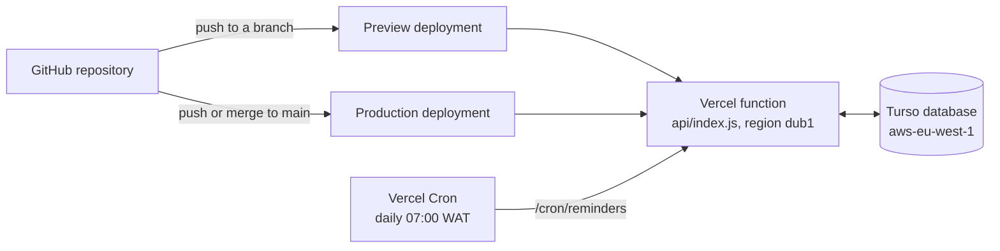

### Initial setup

1. **Import the repository** at [vercel.com/new](https://vercel.com/new) using *Import Git Repository*. Select the framework preset **Other** and leave the build, output and install commands at their defaults.
2. **Add the database.** In the Vercel project, open *Storage*, select *Create Database* and choose **Turso** in the **Ireland (aws-eu-west-1)** region, then connect it to the project. This adds `TURSO_DATABASE_URL` and `TURSO_AUTH_TOKEN` automatically. Alternatively, create the database at [turso.tech](https://turso.tech) and add both variables manually.
3. **Add environment variables** under *Settings* > *Environment Variables* (Production and Preview):

   | Variable | Value |
   |---|---|
   | `SESSION_SECRET` | A long random string, for example from `node -e "console.log(require('crypto').randomBytes(32).toString('hex'))"`. **Required**; the application will not start without it. |
   | `CRON_SECRET` | A second long random string, sent by Vercel when calling `/cron/reminders`. |
   | `SEED_DEMO` | `true` to load the demonstration data into the empty database on first start. |
   | `APP_URL` | The deployment address, used in email links. |
   | `SMTP_*`, `MAIL_FROM` | Required for real email delivery (see [Sending email with Resend](#sending-email-with-resend)). |

4. **Redeploy** so that the new variables take effect.

The first request after deployment creates the database tables (and loads the demonstration data if
`SEED_DEMO=true`). Every push to a branch creates a **preview deployment**; pushes to `main` deploy to **production**.

> [!NOTE]
> **Reminders on Vercel.** As there is no continuously running process, reminders are sent during normal traffic (at
> most once per minute) and by a **daily Vercel Cron job** at 07:00 WAT. When the server is run with `npm start`, the
> reminder job runs every minute.

---

## Configuration

All settings are environment variables, normally placed in a `.env` file (see [.env.example](.env.example)).

<details>
<summary><b>Show all settings</b></summary>

| Variable | Default | Purpose |
|---|---|---|
| `PORT` | `3000` | HTTP port. |
| `APP_URL` | `http://localhost:3000` | Public address, used in email links. |
| `NODE_ENV` | `development` | Set to `production` for secure cookies and hidden error details. |
| `SESSION_SECRET` | development value | **Required in production.** A long random string. |
| `SESSION_MINUTES` | `30` | Idle time in minutes before automatic sign-out. |
| `DB_PATH` | `data/uhs.db` | Local SQLite database file (ignored when `TURSO_DATABASE_URL` is set). |
| `TURSO_DATABASE_URL`, `TURSO_AUTH_TOKEN` | empty | Hosted Turso database; required on Vercel. |
| `SEED_DEMO` | unset | `true` loads demonstration data into an **empty** database on first start. |
| `CRON_SECRET` | empty | Secret for the `/cron/reminders` endpoint (Vercel Cron). |
| `CLINIC_OPEN` / `CLINIC_CLOSE` | `08:00` / `16:00` | Consultation hours (West Africa Time). |
| `SLOT_MINUTES` | `20` | Length of each appointment slot. |
| `CLINIC_DAYS` | `1,2,3,4,5` | Consultation days (0 = Sunday). |
| `MAX_DAYS_AHEAD` | `30` | Maximum number of days ahead that patients can book. |
| `JITSI_DOMAIN` | `meet.jit.si` | Video server (see [Limitations and future work](#limitations-and-future-work)). |
| `SMTP_HOST`, `SMTP_PORT`, `SMTP_USER`, `SMTP_PASS`, `MAIL_FROM` | empty | Email delivery for reminders, notifications and password resets. Leave `SMTP_HOST` empty to record emails in the outbox only. |
| `ADMIN_EMAIL`, `ADMIN_PASSWORD` | see above | Initial administrator, created on first start if none exists. |
| `TRUST_PROXY` | unset | Set to `1` behind a reverse proxy that terminates HTTPS (automatic on Vercel). |

</details>

### Sending email with Resend

The application sends email over SMTP, so [Resend](https://resend.com) can be used without code changes:

1. In Resend, add and verify a domain (**Domains > Add Domain**, then add the DNS records shown at the domain registrar).
2. Create an API key (**API Keys > Create API Key**, with *Sending access* permission).
3. Set the following variables (in `.env` locally, and in Vercel under **Settings > Environment Variables**):

   ```
   SMTP_HOST=smtp.resend.com
   SMTP_PORT=465
   SMTP_USER=resend
   SMTP_PASS=re_your_api_key
   MAIL_FROM=UHS Telemedicine <no-reply@yourdomain.com>
   APP_URL=https://your-site-address
   ```

   `MAIL_FROM` must use the verified domain, and `APP_URL` must be the real site address, as password-reset and email-confirmation links are built from it.
4. Restart or redeploy, sign in as an administrator, open **Email outbox** and select **Send me a test email**.

All times are handled in **Africa/Lagos** time (WAT, UTC+1).

---

## System design

### Architecture

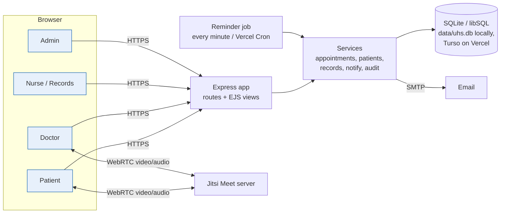

- **Routes** (`src/routes`) handle HTTP requests for each area of the application (patient, doctor, records, administration, messages).
- **Services** (`src/services`) contain the business rules, including slot generation, booking, duplicate detection, reminders and notifications.
- **Views** (`src/views`) are EJS templates; `public/` holds the stylesheets and client-side scripts.
- The **reminder job** runs every minute; a `reminders_sent` table ensures that each reminder is sent only once.
- Video and audio travel **directly between browsers through the Jitsi server**; the application only generates the private room name.

### Live updates

Signed-in pages update without reloading ([public/js/live.js](public/js/live.js)):

| Element | Mechanism |
|---|---|
| Unread counters and notification pop-ups | Each page polls `/live` (`/staff/live` for staff, `/admin/live` for administrators) every 5 seconds for counters and new notifications. |
| Lists (notifications, conversations, the doctor's queue, the patient's appointments) | When a change is detected, the list is fetched again and replaced in place. |
| Open conversation | Polls `/messages/<patient>/<doctor>/updates` every 2.5 seconds for new messages, read receipts and typing status. Messages are sent in the background. |
| Background tabs | Poll every 30 seconds and refresh immediately when shown again. A conversation is marked as read only while it is on screen. |

Polling is used instead of persistent connections because Vercel serverless functions cannot hold WebSocket
connections; the approach works identically on any host. Background requests do not count as user activity, so the
30-minute idle sign-out still applies. Every page remains fully functional without JavaScript.

### Remote consultation flow

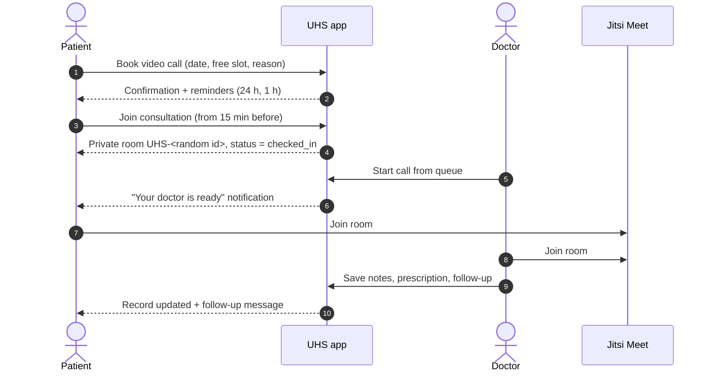

### Appointment life cycle

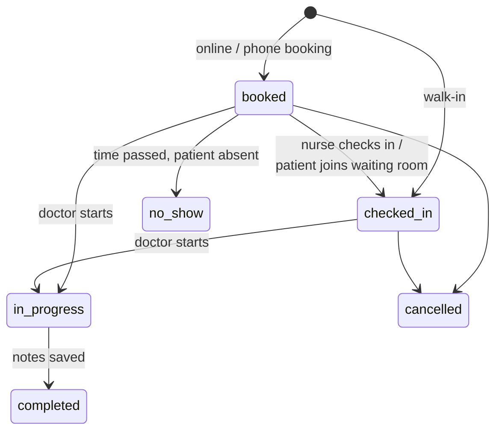

**Waiting time** is measured from `checked_in_at` (arrival, or joining the online waiting room) to `started_at` (when the doctor starts the consultation).

### Key business rules

- Slots are generated from clinic hours; past slots and non-clinic days are never offered.
- A doctor cannot be double-booked. This is checked in the application and enforced by a **unique database index** on `(doctor_id, scheduled_at)`, so it holds even under simultaneous bookings.
- A patient cannot hold two active appointments at the same time.
- "First available doctor" selects the free doctor with the **fewest appointments that day**.
- Remote consultations require an online account; patients without one can still be booked in person by telephone.
- Patients can join the call from **15 minutes before** the appointment until the end of that day.

---

## Database design

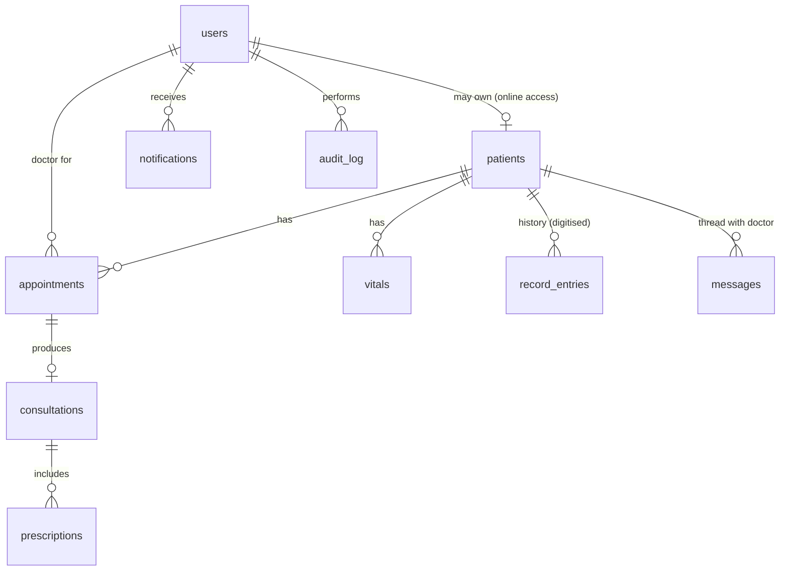

<details>
<summary><b>Table descriptions</b></summary>

| Table | Purpose |
|---|---|
| `users` | All users who can sign in, with a role of `patient`, `doctor`, `nurse` or `admin`. |
| `patients` | The medical record: UHS number, matric/staff number, demographics, allergies, old paper file number and digitisation status. May exist without a user account (walk-ins). |
| `appointments` | Bookings and walk-ins, with mode, status, booking channel, private room identifier and check-in, start and end times. |
| `vitals` | Blood pressure, temperature, pulse and other measurements taken at triage. |
| `consultations` | The doctor's notes for an encounter, including the follow-up date and note. |
| `prescriptions` | Medicine lines linked to a consultation. |
| `record_entries` | History copied from paper files or reported by the patient or other hospitals. |
| `messages` | Secure patient-doctor messages. |
| `message_images` | Photographs sent in messages, stored in the database and accessible only to the two participants. |
| `quick_calls` | Video or audio calls started by a doctor from a conversation, with room identifier and start and end times. |
| `typing` | Typing status per conversation for the live typing indicator. |
| `notifications` | In-app notifications, each linked to its subject. |
| `reminders_sent` | Prevents duplicate reminders. |
| `email_outbox` | Record of every email sent or logged. |
| `audit_log` | Record of who performed which action and when. |
| `sessions` | Sign-in sessions. |
| `email_verifications` | Email confirmation links for self-registered patients (hash only; valid for 24 hours). |
| `password_resets` | One-time password-reset links for patients (hash only; valid for 1 hour). |

</details>

The complete, commented schema is in [src/db/schema.sql](src/db/schema.sql).

---

## Security and privacy

Health information is classed as sensitive personal data under the **Nigeria Data Protection Act 2023 (NDPA)**. The
system implements the following controls:

| Area | Control |
|---|---|
| Consent | Explicit consent at self-registration, with an explanation of how data is used. |
| Passwords | **Hashed with bcrypt**; minimum of 8 characters with letters and numbers. Temporary passwords issued by staff **must be changed at first sign-in**. |
| Access control | Role checks on every route (see the [access matrix](#access-matrix)). Administrators cannot view clinical records; nurses cannot view consultation notes. |
| Audit | Sign-ins (including failures), every patient-record view and every change are logged. |
| Brute-force protection | Five failed sign-ins for an email/IP combination lock it for 15 minutes. Failed sign-ins take a similar time whether or not the account exists. |
| Sessions | HTTP-only, SameSite cookies; session identifier regenerated at sign-in; **30-minute idle timeout**; `Secure` cookies in production. |
| Forms | **CSRF tokens** on every form. |
| Browser | **Content Security Policy** and other security headers; no inline scripts; only the Jitsi domain may load scripts or frames; `Cache-Control: no-store` on pages. |
| Injection and redirects | Parameterised SQL throughout; redirects restricted to local paths. |
| Call privacy | 24 random hexadecimal characters per appointment room and per call, never reused. Only the patient and doctor concerned can open a call. |
| Email | Notification emails state only that a message exists; message content remains in the system. |
| Photographs | Converted to JPEG in the browser; the server accepts only JPEG, PNG, WebP or GIF files whose content matches their type (up to 2.5 MB), and serves them only to the two participants. |
| Email ownership | Self-registered patients must confirm their email address before using the service. |
| Identity | A self-registration that matches an existing record is refused and referred to the records office, preventing anyone from claiming another person's file online. |

> [!WARNING]
> **For a production deployment**, additionally serve the application over **HTTPS**, set a strong `SESSION_SECRET`,
> back up the database regularly to an encrypted location, self-host Jitsi on university infrastructure, and agree a
> data-retention policy with UHS.

---

## Testing

```bash
npm test
```

```
tests 24
pass 24
fail 0
```

The 24 automated tests run against a temporary database that is deleted afterwards.

- **Unit tests** ([tests/unit.test.js](tests/unit.test.js)) cover date handling, UHS number generation, duplicate detection (reordered names, telephone formats, ID numbers), form validation, slot generation, least-busy doctor assignment, double-booking prevention (application and database level), single delivery of reminders, safe redirects, password policy, doctor titles and transactions (rollback and nested calls).
- **End-to-end HTTP tests** ([tests/http.test.js](tests/http.test.js)) cover:
  - The complete patient journey: registration, email confirmation, blocked duplicate registration, booking, consultation with prescription, access to the record and follow-up message, patient reply, and denial of access to another patient's messages.
  - Records office functions: registration with duplicate warning and override, walk-ins, vital signs validation, restriction from clinical notes, and enabling online access with a forced password change.
  - Administration: dashboard, user creation and deactivation, test email, and restriction from clinical records.
  - Separation of portals for patients, staff and administrators, including redirects from legacy addresses.
  - Email confirmation and password reset: link expiry, single use, resend limits and identical responses for unknown accounts.
  - Notifications and live updates: notification links, counters, typing indicators, read receipts, photo access control and doctor-initiated calls.
  - Idle timeout, staff profile updates, CSRF rejection, failed-login auditing and access-control redirects.

---

## Project structure

<details>
<summary><b>Show folder tree</b></summary>

```
Remote-HealthCare/
├── src/
│   ├── server.js            # Entry point: starts the web server and reminder job
│   ├── app.js               # Express setup, middleware and routes
│   ├── config.js            # Settings from environment variables
│   ├── db/
│   │   ├── schema.sql       # Database tables (documented)
│   │   ├── index.js         # Database helper (libSQL: local file or Turso)
│   │   ├── session-store.js # Sessions stored in the database
│   │   ├── bootstrap.js     # Startup: tables, first administrator, optional demo data
│   │   ├── demo-data.js     # Demonstration data, written in one atomic batch
│   │   └── seed.js          # npm run seed
│   ├── middleware/
│   │   ├── auth.js          # Sign-in and role checks
│   │   └── security.js      # Security headers, CSRF, login rate limiting
│   ├── services/
│   │   ├── appointments.js  # Slots, booking and life cycle
│   │   ├── patients.js      # Registration, UHS numbers, duplicate detection, search
│   │   ├── records.js       # Assembles the medical record
│   │   ├── reminders.js     # Reminder background job
│   │   ├── notify.js        # In-app notifications and email
│   │   ├── live.js          # Unread counters and new notifications for live updates
│   │   └── audit.js         # Audit log
│   ├── routes/              # Route handlers for each area of the application
│   ├── utils/               # time.js (dates in WAT), validate.js (input checks)
│   └── views/               # EJS templates per area and shared partials
├── public/
│   ├── css/style.css
│   ├── js/                  # Client scripts: app, booking, consultation, live updates
│   └── vendor/              # Font Awesome, Outfit font and image decoders
├── api/index.js             # Vercel serverless entry point
├── docs/
│   ├── images/              # University of Ibadan logo
│   └── media/               # Screenshots and walkthrough
├── tests/                   # Automated tests
├── .env.example
├── vercel.json              # Vercel routing, region, cron and function settings
└── package.json
```

</details>

---

## Limitations and future work

> [!CAUTION]
> **Public Jitsi server limits.** The free `meet.jit.si` service **limits embedded calls to approximately 5 minutes**
> and may require the first participant to sign in. For demonstrations, the **Open call in new tab** option avoids
> the embedding limit. For production use, UHS should **self-host Jitsi** on a university server (or use 8x8 JaaS)
> and set `JITSI_DOMAIN` accordingly.

- **SMS reminders** were not implemented, as they require a paid provider such as Termii or Twilio. Email and in-app reminders are included, and `services/notify.js` is the single point at which an SMS channel would be added.
- **Integration with existing records.** No external UHS system was available, so paper files are digitised manually by the records office. A future version could import from an existing system once its format and authorisation are agreed.
- **Scheduling.** All doctors share one set of clinic hours; there is no per-doctor rota or leave management.
- **Pharmacy and laboratory.** Prescriptions are printable and visible to the patient, but there is no dispensing workflow or laboratory request and result module.
- **Staff password resets** are performed by an administrator by design; only patients can reset by email.
- **Database scale.** SQLite/Turso is appropriate for a campus clinic; a much larger deployment could migrate to PostgreSQL, as the SQL is largely standard.
- **Reminder frequency on Vercel Hobby** is limited to site traffic and one daily cron job; a paid plan or a conventional server provides minute-by-minute reminders.
- **Two-factor authentication** for staff accounts would further strengthen security.

### Assumptions

- Patients are University of Ibadan students, staff or registered dependants, identified by matric or staff number.
- Consultation hours are Monday to Friday, 08:00 to 16:00, with 20-minute slots (all configurable).
- The doctor decides whether a case is suitable for remote care; the plan field can direct a patient to attend in person.
- Nurses and records officers share one role, as both handle registration, check-in and vital signs.

---

## Troubleshooting

| Problem | Solution |
|---|---|
| `--env-file-if-exists` is not a valid option | Upgrade Node.js to version 22 or newer. |
| Vercel: "SESSION_SECRET must be set in production" | Add `SESSION_SECRET` to the project's environment variables and redeploy. |
| Vercel: data disappears, or "no such table" | `TURSO_DATABASE_URL` or `TURSO_AUTH_TOKEN` is missing. Connect the Turso database to the project and redeploy. |
| Port 3000 already in use | Use another port: `PORT=3001 npm start` (PowerShell: `$env:PORT=3001; npm start`). |
| Video area reports that the service could not be loaded | Check the internet connection or firewall, or select **Open call in new tab**. |
| Camera or microphone not working | Allow access in the browser. Browsers permit camera access only on `localhost` or HTTPS sites. |
| Call ends after approximately 5 minutes | This is the `meet.jit.si` embedding limit; use **Open call in new tab** or a self-hosted Jitsi server. |
| "Form expired" message | The session timed out. Refresh the page and try again. |
| No free slots shown | The date is a weekend or holiday, in the past, more than 30 days ahead, or fully booked. |
| Clean database required | Stop the server, then run `npm run seed` (demonstration data) or delete the `data/` folder (empty system). |

---

<div align="center">

<sub>Developed as a case study for the <b>University Health Service, University of Ibadan</b>. CSC 476 Project, Group 62, 2025/2026.</sub>

<sub><i>This platform is not intended for emergencies. In an emergency, attend the UHS emergency unit in person.</i></sub>

</div>
